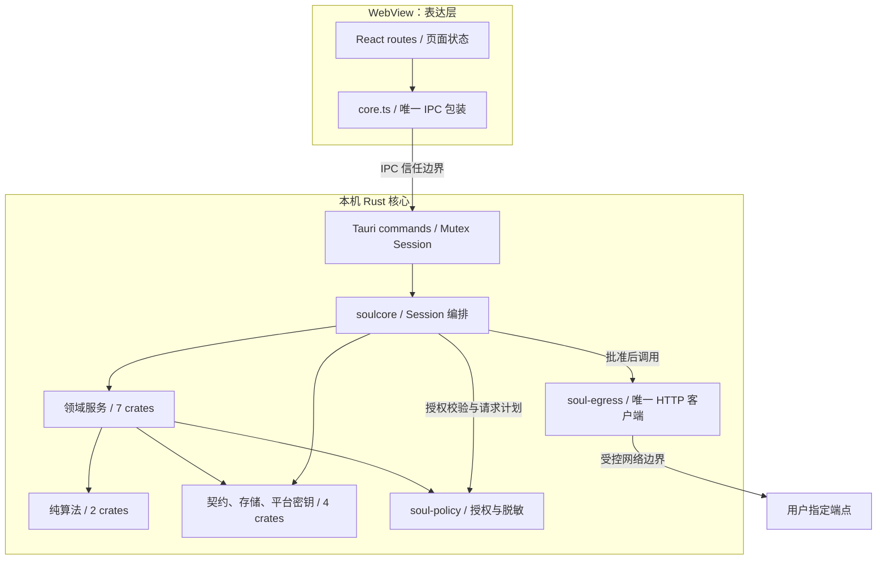
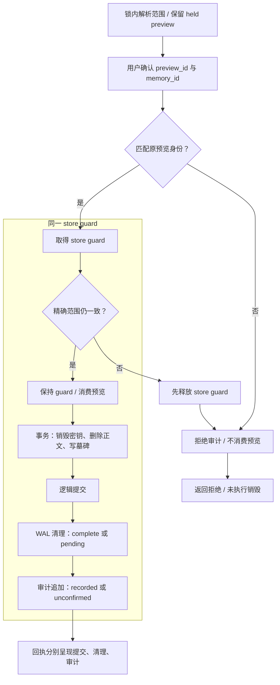
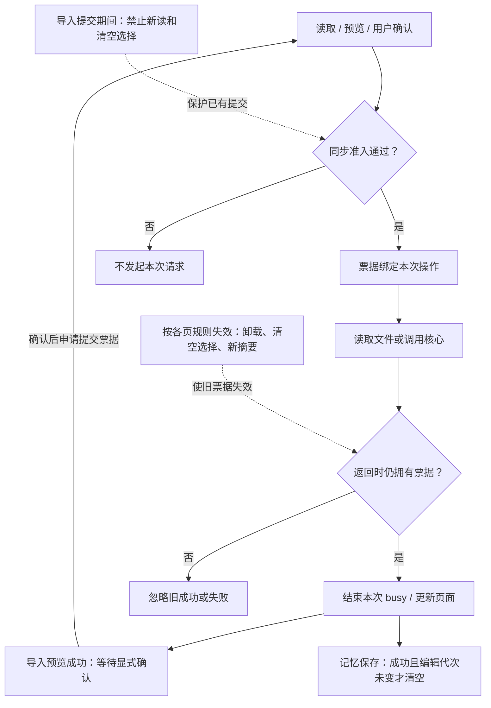
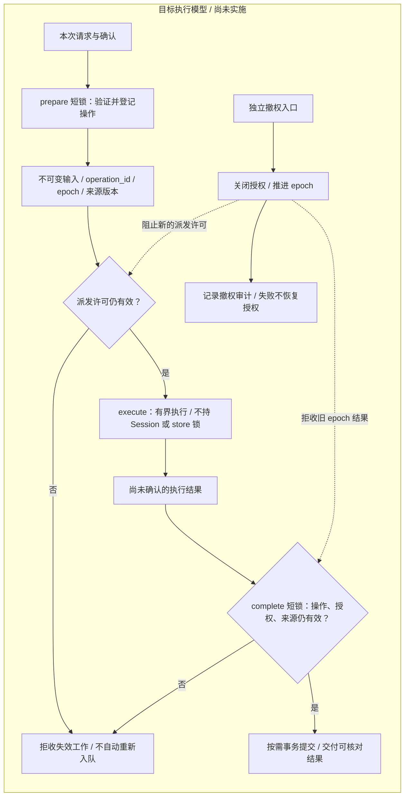

# Soul 架构与演进图

**2026-10-16 当前框架：** 在 `b66f093a1407887eb873fe33defe984906252d29` 上续写的 W1–W5 已接入，并经过逐模块规划与独立源码复审。最终检查结果以 [STATUS](STATUS.md) 为准；源码完成不等于已合入 main 或完整平台验收。入口为 [HTML 框架页](framework-design.html) 与[剩余模块计划](design/2026-10-16-remaining-implementation.md)。

| 模块 | 当前实现与边界 | 源码入口 |
| --- | --- | --- |
| W1 扫描 owned 工作 | Session 内准入并移交唯一 file-plan ledger，锁外执行原只读扫描，完成时归还资源、审计并重验来源。扫描与 E1/导入共用物理慢工作槽，失效不提前释放 worker；页面校验输入及挂载归属 | [Session](../crates/soulcore/src/commands/session.rs)、[Files](../apps/desktop/src/routes/Files.tsx) |
| W2 本次记忆上下文 | 最多 32 个明确候选 UUID；只在本次候选内按关键词、类型选择。缺少事实有效时间时，特定时间问题返回 Clarify。完整本地出处可预览，默认 local；只有本快照中明确 Owner 的单独勾选项可进入既有 E1 批准，paste 豁免不扩给 memory | [selection](../crates/soul-memory/src/selection.rs)、[Session memory](../crates/soulcore/src/commands/session_memory.rs)、[DraftMemory](../apps/desktop/src/routes/DraftMemory.tsx) |
| W3 持久导入与恢复 | core 持有唯一不可变 StagedImport；交付预览前持久记录 reserved，确认只带 operation/preview UUID。锁外工作完成领域、图谱、原导入审计及 committed 回执同事务。OS lease 保持到真实 store/worker 所有者结束；重启只查询终态或 interrupted，不恢复正文、批准或自动重放 | [Session import](../crates/soulcore/src/commands/session_import.rs)、[import operations](../crates/soul-store/src/import_ops.rs)、[durableImport](../apps/desktop/src/routes/durableImport.ts) |
| W4 自然键去重与迁移 | schema 3 原子迁移；按 namespace + conversation ID + external message ID 匹配，任意外部 ID 封存在既有内容密钥下，不新增正文 hash。Telegram 绑定稳定本人账号，JSONL 明确选择来源；同键内容/元数据变化整次冲突。旧行缺 ID 默认拒绝，显式 forward-only 只建立本次及后续索引，历史可能重叠。遗忘同事务销毁密钥、删除封存索引并撤销相关 namespace，墓碑/撤销状态阻止重导复活 | [indexed import](../crates/soul-import/src/indexed.rs)、[schema](../crates/soul-store/src/sql.rs)、[forget](../crates/soul-store/src/forget.rs) |
| W5 自动本地反馈 | 导入提交事务内生成既有 A2 人物统计，不调用端点或另造评分。依赖快照保存 UUID、数值、固定状态及既有 conversation_ref 的规范字节编码；读取/重启时重验关系、完整证据和事件密钥可读性。变化后不展示旧摘要，历史操作计数可保留；ignore 只影响该 bundle，不训练或改事实；recompute 新建同操作的新 UUID，缺失/已遗忘/撤销来源拒绝重算 | [insights service](../crates/soulcore/src/commands/insights.rs)、[insight store](../crates/soul-store/src/insights.rs)、[LocalInsights](../apps/desktop/src/routes/LocalInsights.tsx) |

W2 的 64 KiB 上限由实际请求所用 JSON serializer 计算完整脱敏请求的字节数；超限按整条记忆裁剪，并重算预览、引用、保留 UUID 与 Owner 勾选。它不是 token 数，也不授予长期用途或研究许可。起草及人物摘要继续使用 prepare / 锁外 execute / complete，先审计已发生请求再决定接收；旧结果和已显示来源在相关变更后失效。已发许可仍可能完成出网，失效不等于撤回已发字节。

W5 的候选现可通过既有 contact/evidence UUID 定位到唯一当前关系和指定证据元数据，使用已有标识提示并聚焦关系标题。最多 64 个唯一引用、8192 字符；超过容量不生成精确链接，也不裁剪后冒称完整依据。定位只核对当前元数据存在，不认证历史陈述仍最新，不解密原始材料或自动请求摘要。导入统计尚不能直接选入起草上下文；手写记忆与导入统计的契约不能混用。连续性回归、页面时序及现代导入审计修复见[本轮计划与结果](design/2026-10-16-workflow-continuity.md)。

本轮未改变 T4D/A0–A3、默认出网或只起草不代发边界。静态 Tauri 命令断言不能当作原生 IPC；当前环境缺原生 GTK/WebKit 开发依赖。完整 G-L 继续暂缓，G-W/G-M 未运行，Goal 1、正式 Goal 2 与 Wave 1 均未关闭。最终测试数量由 STATUS 记录，本页不预报。

## 固定历史图与研究基线

以下系统图、操作图及 [architecture.html](architecture.html) 保留 10 月 15 日固定基线；其中“待迁移”“尚未接入”只描述当时版本。起草图和[起草验证](design/2026-10-16-draft-implementation.md)、[导入/摘要接线记录](design/2026-10-16-import-summary-continuation.md)也各有自己的版本范围，不能替代上方 W1–W5 现状。

[打开离线 HTML 架构地图](architecture.html)：下载后在浏览器打开，可切换四张图、点击节点阅读职责、缩放浏览、筛选 18 个模块，并下载 SVG 或 Mermaid 源文件。页面内嵌全部资源，不自动联网；说明固定在 `b47ddfa`，不是实时状态或 Soul 客户端。

历史使用框架与算法提案：[交互研究 HTML](framework-design.html) / [详细设计](design/2026-10-15-usage-framework.md)。独立评审的参考算法、目标流程 SVG/Mermaid 与实验记录保持非生产研究范围；HTML 顶部另列最新接线状态。

历史图更新日期：2026-10-15。以下各图描述固定基线 `9d3cd300c19c996f9edabf337c9d359fcb594bc3` 的改动；“已实现”指该版本源码能力，不代表当前全部实现或全部平台验收。依据见[架构审查](reviews/2026-10-15-architecture-review.md)和[验证记录](reviews/2026-10-15-validation.md)。

Soul 是本地桌面应用：React WebView 负责表达，Tauri 连接同一应用的 Rust 核心，领域 crate 在核心进程内协作。下图中的分组不是微服务，也不代表独立部署。WebView 的平台进程安排由 Tauri/WebView 运行时决定；这里不把整个桌面应用说成严格的单操作系统进程。

## 1. 当前系统：分层与信任边界

图中实线表示主要调用或数据通路，不是完整 Cargo 依赖图。授权仍由核心判定；按钮禁用、页面票据和 IPC 类型都不能代替领域授权。

[查看 SVG](architecture/current-system.svg) · [Mermaid 源文件](architecture/current-system.mmd)

根 [Cargo workspace](../Cargo.toml) 的 18 个 crate 按职责分组如下；桌面 [Tauri workspace](../apps/desktop/src-tauri/Cargo.toml) 独立构建，不计入这 18 个。

| 分组 | crate | 职责 |
| --- | --- | --- |
| 应用编排，1 个 | `soulcore` | Session 生命周期、命令编排、共享 store 和授权上下文 |
| 领域服务，7 个 | `soul-memory`、`soul-profile`、`soul-graph`、`soul-import`、`soul-draft`、`soul-collect`、`soul-fileplan` | 记忆、档案、关系、导入、起草、采集、只读文件计划 |
| 策略与出口，2 个 | `soul-policy`、`soul-egress` | 许可、origin、脱敏与受控 HTTP；出口不分散到页面或领域服务 |
| 契约、存储与密钥，4 个 | `soul-schema`、`soul-store-api`、`soul-store`、`soul-win-dpapi` | 数据类型、存储接口、SQLCipher 与字段加密、Windows 密钥保护适配 |
| 纯算法，2 个 | `soul-algo-tie`、`soul-algo-trait` | 冻结的判档、推断与表达规则，不持数据库或网络能力 |
| 验证工具，2 个 | `soul-testkit`、`xtask` | 合成 fixtures、mock transport、现有质量检查；不在生产调用链中 |

关键关系可直接追到代码：

- [core.ts](../apps/desktop/src/core.ts) 是前端唯一 Tauri API 包装；[commands.rs](../apps/desktop/src-tauri/src/commands.rs) 持有 `Mutex<Session>` 并转发命令。
- [Session](../crates/soulcore/src/commands/session.rs) 组合领域服务和共享 store。[PolicySession](../crates/soulcore/src/commands/policy.rs) 通过 `soul-policy` 完成校验，最终调用 [soul-egress](../crates/soul-egress/src/lib.rs)；图中没有把 `soul-policy` 误画成直接持有 HTTP 客户端。
- [soul-draft](../crates/soul-draft/Cargo.toml) 的生产依赖不含 HTTP 客户端；生成能力由调用者注入。[store-api](../crates/soul-store-api/src/lib.rs) 与 [store](../crates/soul-store/src/lib.rs) 分别表达接口和实现。
- 此固定基线的长任务仍可能占用 Session 锁；第 4 图保留当时解决方向。最新生产路径见上方 W1–W5 与各自实现记录。

## 2. 已实现：遗忘范围重验与结果分离

预览记录精确的主键集合和统计，确认时在同一个 store guard 内重验后再销毁。相同数量的证据、推断或 blob 被替换，也会使旧范围失效；仅比较计数无法发现这一变化。

[查看 SVG](architecture/forget-flow.svg) · [Mermaid 源文件](architecture/forget-flow.mmd)

[ForgetScope](../crates/soul-store/src/forget.rs) 使用既有 UUID，不保存正文，不序列化到 IPC，也不新增哈希协议或表。它包括内容密钥、记忆、联系人、证据、存活推断、sealed blob ID 和影响统计。保证范围限定于当前单 writer、共享 store guard 模型；未来增加独立 writer 时，必须把重验纳入存储销毁事务。

[Session::forget_memory](../crates/soulcore/src/commands/session.rs) 先检查预览身份，再取得 store guard。范围不匹配时，先释放 guard，再追加拒绝审计，避免递归获取同一 Mutex。旧预览不被消费；影响范围已改变时，需要重新读取预览后才能执行。图中的身份或范围拒绝通常返回 `PLAN_HASH_MISMATCH`；拒绝审计本身失败时返回该存储问题。范围查询错误也直接返回错误，不能当作已销毁。

提交后的领域结果 [MemoryForgetOutcome](../crates/soul-memory/src/outcome.rs) 与 IPC 回执 [ForgetReceiptView](../crates/soulcore/src/commands/memory.rs) 共同表达三个独立结论。领域结果包含 `receipt`、`cleanup` 和 `audit`；`logical_committed` 是 IPC 回执字段，不是领域类型字段：

| 结果 | 可以确认什么 | 不能推导什么 |
| --- | --- | --- |
| `logical_committed` | 逻辑销毁事务已提交 | 不证明 WAL 已清理或审计已确认 |
| `cleanup` | 本次 WAL 清理 complete 或 pending | 不证明历史销毁或审计状态 |
| `audit` | 审计 recorded 或 unconfirmed | unconfirmed 不等于审计未写入 |

[仅重试日志清理](../crates/soul-memory/src/outcome.rs) 不重新销毁、不补写审计；因此图中没有把清理重试画回整条销毁流程。[ForgetResult](../apps/desktop/src/components/ForgetResult.tsx) 分别呈现这些结果。旧 IPC 回执缺少字段时保持未确认，不默认补成成功。这里不承诺 SSD 物理擦除。

## 3. 已实现：页面请求归属与迟到结果

请求先同步准入，再调用工作函数；返回时只有仍拥有票据的页面能够更新状态。此图概括共同约束，具体失效规则仍保留在各页面的协调对象中，没有新增通用工作流引擎。

[查看 SVG](architecture/request-lifecycle.svg) · [Mermaid 源文件](architecture/request-lifecycle.mmd)

| 页面 | 实际规则 | 代码入口 |
| --- | --- | --- |
| 记忆 | 单次操作独占；新操作使旧列表请求失效；销毁确认必须引用持有的预览 | [MemoryRequests](../apps/desktop/src/routes/memoryRequests.ts)、[Memory](../apps/desktop/src/routes/Memory.tsx) |
| 记忆输入 | 收到成功且编辑代次未变化，才清空本次草稿；失败、准入拒绝、期间编辑或卸载不会抹掉新输入 | [Write 与 act](../apps/desktop/src/routes/Memory.tsx)、[写入回归](../apps/desktop/src/routes/Memory.write.test.tsx) |
| 导入 | 成功预览绑定原始格式；提交期间禁止新读与清空归属；清空文件选择只使未提交读取/预览失效 | [ImportRequests](../apps/desktop/src/routes/importRequests.ts)、[Import](../apps/desktop/src/routes/Import.tsx) |
| 图谱 | 新人物摘要替代旧摘要归属；图写入使旧摘要失效；旧摘要成功和失败都不能覆盖当前选择 | [GraphRequests](../apps/desktop/src/routes/graphRequests.ts)、[Graph](../apps/desktop/src/routes/Graph.tsx) |

“忽略旧结果”只发生在页面层：已经启动的文件读取、核心调用或网络传输可能继续。它不等于取消核心工作、撤销权限或回滚事务。保存保留输入也不证明写入没有发生，因此没有加入自动重发。

在这张历史图对应的版本中，D55 仍是后续设计：没有消息级幂等，丢回执后重复提交可能重复写入。该阶段请求状态修复未改变重导或授权语义；现行 W3/W4 则按 D73–D75 引入不可变预览、持久回执、自然键及遗忘撤销。图中旧页面协调模型不代表新持久协议的全部状态。

## 4. 历史目标图：短锁执行与独立撤权

以下为 10 月 15 日未接线时的目标图，保留原图及一般化提案。此后起草、人物摘要、扫描和导入已逐用例接线；W1–W5 没有把它实现为一个通用调度引擎。图内“尚未实施”和下表建议边界只属于该历史设计，当前锁与事务边界以顶部源码入口为准。

[查看 SVG](architecture/target-execution.svg) · [Mermaid 源文件](architecture/target-execution.mmd)

三个阶段先放在 `soulcore` 内部模块中，保留现有领域 crate 和单 writer，不新增微服务：

| 阶段 | 建议边界 | 必须验证 |
| --- | --- | --- |
| prepare | 短临界区校验本次请求、端点和来源，登记 operation，形成不可变工作输入 | IPC 参数不能构造已批准工作；不在锁内等待 HTTP 或大文件解析 |
| execute | 有界执行，不持有 Session/store guard；只能产生未确认结果 | worker 不直接提交业务状态；不能克隆旧授权上下文重新发许可 |
| complete | 短临界区重验操作、授权 epoch、期限和来源，按需事务提交或交付 | worker 成功不等于结果可接受；失效结果不得自动重新入队 |

独立撤权必须绕开长任务的 Session 锁，并与派发许可分配建立清晰的串行化边界。先关闭授权并推进 epoch，再记录审计；审计失败不能恢复授权。验收首先证明：撤权后不再发放新派发许可，旧 epoch 的结果不能提交。已经派发的请求可能仍在执行，取消也无法撤回已经发出的字节；若要承诺中断进行中的传输，还需单独的可取消网络实现与测试。

实施顺序是：先迁移起草并用 barrier/mock transport 验证撤权交错，再迁移摘要与目录扫描；之后明确 operation receipt 与 D55 幂等/恢复语义，最后接入获准记忆检索和用户纠正回流。不要先引入通用 Agent 调度，再补授权和提交一致性。

## 5. 不随架构图改变的约束

[PRODUCT_LOCK](PRODUCT_LOCK.md)、[DECISIONS](DECISIONS.md)、[算法决议](algorithms/DECISION.md)、[SECURITY](SECURITY.md) 和 [ACCEPTANCE](ACCEPTANCE.md) 继续作为权威。无 E0；E1 保留用户指定 origin、redactor、单次批准与拒绝；只起草不发送；文件功能只读预览；审计不含正文；推断证据可解引用；用户纠正优先。

历史图对应测试见[验证记录](reviews/2026-10-15-validation.md)，最新实现与验证见 [STATUS](STATUS.md)。根 Rust workspace 测试不能代替独立 Tauri workspace；局部通过不代替 G-L、G-W 或真实人工 G-M，也不宣布 Goal 1、正式 Goal 2 或 Wave 1 关闭。

四个 `.mmd` 是对应图的可编辑源文件；本文内嵌 Mermaid 与其保持一致，SVG 为同源导出展示版本。
