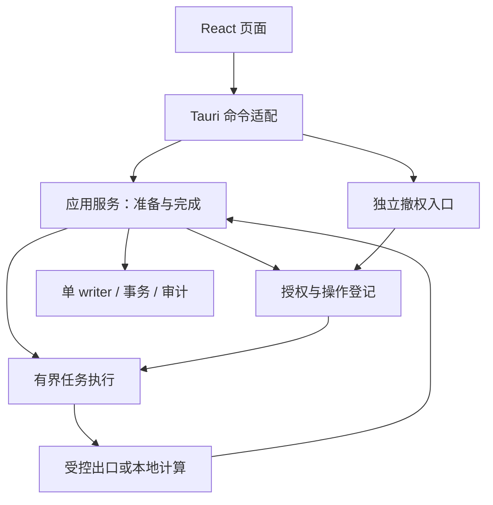

# Soul 架构审查、改造设计与本轮实施

日期：2026-10-15（Asia/Shanghai）。本报告是代码审查与实施说明，不替代 PRODUCT_LOCK、DECISIONS、算法决议或验收矩阵。

## 1. 结论与版本范围

Soul 已有合理的领域模块划分。当前主要瓶颈集中在应用编排、操作生命周期和跨层结果确认，而不是缺少 Agent 框架。建议保留 Rust + Tauri + React、本地加密存储、单 writer、纯算法 crate，将后续投入集中到可撤销的执行编排与可信结果交付。

本次核对 GitHub：`Xhhemoing/Soul` 的 `main` 为 `8aae8f3877bc93529d0a0104c277a85ded9c43aa`；审查和补丁基于 PR #66 的 `codex/soul-forget-outcomes-20260929`，固定提交 `9d3cd300c19c996f9edabf337c9d359fcb594bc3`。PR #66 的 base 是 `codex/soul-followup-20260928`，并非 main。不能将这份补丁直接当成 main 已拥有的功能，也不能把旧版本测试结果移给新代码。

源码通过该 SHA 的 GitHub API 与完整 archive 取得；原始 archive 含 503 个文件。工作副本起初不是具有可解析 HEAD 的完整 clone。初次审查对象是相对固定 archive 的未提交文件差异；随后用户明确授权将代码与架构设计图同步到原工作分支。PR 保持草稿，未合入 main，提交身份以本文件所在 Git 历史为准。最终测试记录见 [验证记录](2026-10-15-validation.md)；交付包另含原始日志。图示入口为 [系统架构与设计图](../ARCHITECTURE.md)。

## 2. 当前架构：值得保留的部分

根 workspace 有 18 个 crate；`apps/desktop/src-tauri` 是独立 workspace。以下是生产依赖方向的概括，不是建议新增的服务或进程。

| 层 | 现有模块 | 设计价值 |
| --- | --- | --- |
| 表达与平台 | React routes、core.ts、Tauri commands | UI 展示核心结果，Tauri 转发命令，平台差异位于外侧 |
| 应用编排 | soulcore / Session / commands | 组合授权、领域操作、存储和审计；是本轮主要改进点 |
| 领域服务 | memory、profile、graph、import、draft、collect、fileplan | 已按业务结果划分，没有必要重写为通用 Agent 工具集合 |
| 策略与出口 | soul-policy、soul-egress | HTTP 集中在出口模块；origin、一次性许可和 redactor 有明确边界 |
| 事实与持久化 | soul-schema、soul-store-api、soul-store、soul-win-dpapi | 契约、存储接口、SQLCipher/字段加密和平台密钥有独立职责 |
| 算法 | soul-algo-tie、soul-algo-trait | 纯计算、独立于 HTTP/Tauri/数据库；冻结规则应继续保持 |
| 验证工具 | soul-testkit、xtask | 合成数据、mock endpoint、故障注入和已有审计入口可继续使用 |

原始 Session 约 1,900 行，core.ts 943 行，Tauri commands 约 446 行。行数只是职责聚集的线索，不能单凭行数决定拆文件。真正的耦合证据是同一 Session 锁覆盖状态读取、解析、扫描和阻塞网络调用；同一个页面同时承担输入编辑、请求准入、旧结果失效和结果确认。

已有正确设计应保留：导入与图重建在同一事务；采集复用共享 store；遗忘区分 logical commit、cleanup、audit；起草的 preparation ID、plan hash、origin 分别绑定不同风险；用户纠正优先；A1 在当前单来源数据下不触发属于冻结设计，不应以“提高智能”为由改算法。

## 3. 按实际影响排序的问题

| 优先级 | 证据与根因 | 用户影响 | 本轮状态 |
| --- | --- | --- | --- |
| P0 | Session::forget_memory 原先只比较 preview_id / memory_id，再执行遗忘 | 预览后依赖扩大，旧确认仍可能销毁新范围 | 已实施精确范围重校验，并新增存储/Session 回归 |
| P0 | Tauri SessionState 为 Mutex<Session>；generate_draft 经 policy 调 blocking HTTP，期间持有 Session | 慢请求占用其他命令入口，撤权无法独立及时处理 | 完成下文实施设计；未假称已改造或已具备及时撤权 |
| P1 | Memory.Write 在保存成功前清空 title/summary | 核心拒绝、IPC 丢失或准入失败时丢输入 | 已修复；等待确认后按编辑代次清空 |
| P1 | Import 清空选择走 reset，但 reset 正确地拒绝正在读取时的通用重置 | 清空后的旧成功/失败结果回写页面，影响新预览 | 由真实失败回归定位并修复；提交期间仍禁止清空归属 |
| P1 | Import 把未知提交结果与明确失败共用重试入口；底层尚无消息级幂等 | 已入库但回执丢失后再次提交，可能重复导入 | 既有 D55 后续事项；本轮未擅改重导/遗忘后导入语义 |
| P1 | 既有 PR 中多项 Rust/React 测试只编写未执行 | 类型、依赖及跨层不兼容可能积累到发布时 | 本轮实际恢复依赖并执行可用的针对性验证；结果单独记载 |
| P2 | “两个连接就是两个 WAL”的注释不符合 SQLite | 容易用错误原因决定锁和连接架构 | 修正当前相关源码说明；历史记录保留历史身份 |
| P2 | 请求序号、页面归属、业务提交结果分散在 route 中 | 表面 UI 取消容易被误解为核心取消或事务回滚 | 本轮修复具体归属缺陷；统一语义，暂不抽万能 hook |

## 4. 本轮已经落实的架构改进

### 4.1 遗忘由“编号相同”升级为“范围仍有效”

在 `soul-store/src/forget.rs` 增加不序列化的 `ForgetScope`：保存已有主键集合及影响统计，包括内容密钥、记忆、联系人、证据、存活推断和 sealed blob ID。它不保存正文，不引入哈希协议、持久化表、schema 迁移或前端可构造的授权对象。

流程变为：预览时记录范围 → 确认时验证原 preview/memory 身份 → 取得现有 store guard → 重新解析并比较范围 → 保持同一 guard 执行遗忘 → 沿用提交后的 cleanup/audit 回执。

只比较数量不够：将证据 A 换为 B，且各自都关联一个推断时，旧 `ForgetImpact` 可能完全相同。新范围比较发现 ID 变化。列表有稳定排序，证据集合沿用 BTreeSet，避免同一集合因顺序变化误拒绝。

拒绝路径在追加审计前释放 store guard，避免递归获取同一 Mutex。保留 `PLAN_HASH_MISMATCH` 和旧预览未消费约定，用户可以重新读取预览；不会自动重复销毁。成功路径不在外面增加事务，因此不会把原有 commit 后 WAL cleanup 错包进未提交事务。

保证范围明确限定为当前单连接、单 writer、共享 store guard 的应用模型。公开的只读检查方法自身不是跨连接原子操作；未来增加 writer 时，必须将重校验纳入存储销毁事务。范围 ID 一致也不等于所有证据正文有版本一致性，未来依赖内容的生成任务仍需单独验证来源版本。

### 4.2 写入确认和草稿编辑分离

`Memory.act` 返回本次页面仍拥有的成功/失败结果。Write 只在收到成功且编辑代次未变化时清空输入。拒绝、未知 IPC 结果、准入失败保留输入；用户期间修改任一字段或卸载页面，会让旧完成结果失去清空资格。即使改动后又改回相同文本，也作为新编辑保留。

这不实现 create-memory 幂等，也不把未知 IPC 结果说成回滚。保留输入不等于证明未入库；本轮没有加入自动重发。

请求协调对象改用 lazy state 初始化，避免在 render 中读取 ref，被真实 lint 捕获的问题也一并修复，没有关闭规则。

### 4.3 区分清空文件选择与通用重置

ImportRequests 保留 reset 的原约束，新增范围很窄的 clearSelection：使已清空选择对应的 read/preview 票据失效；正在提交时拒绝。它处理的是页面结果归属，不声称中断文件读取、取消 native 调用或回滚数据库。

原来四项失败断言不改；新增迟到成功/失败与提交期间清空选择的反例。这样避免用“放宽所有 reset”修好页面、却使提交锁失效。

## 5. 下一步核心架构设计：短锁与可失效工作结果

以下为设计，尚未接入生产代码。建议先迁移一个起草用例并验收，再迁移摘要、目录扫描和导入解析；不要一次替换全部 Session 或引入工作流引擎。

### 5.1 三个阶段及所有权

| 阶段 | 锁内允许的工作 | 产生的对象 | 必须禁止 |
| --- | --- | --- | --- |
| prepare | 验证本次请求、端点、准备 ID、来源状态，登记 operation | 不可变输入、operation_id、authorization epoch、必要的来源版本 | 在锁内等待 HTTP、读取大文件、扫描目录 |
| execute | 不持有 Session/store guard；使用受限执行器 | 未确认的执行结果 | 克隆旧 PolicySession 后自行再发 token；直接写库或直接返回有效产品结果 |
| complete | 重新校验 operation、授权、期限及来源；需要时事务提交 | 可交付结果或明确拒绝 | 只因 worker 返回成功就直接展示；失效结果重新入队 |

对象应以 Rust 私有字段表达能力边界，Tauri 参数不能构造“已批准”的工作。初期放入 `soulcore` 内部模块即可，不必增加 crate；测试通过 injected executor/fake transport 控制交错，真实 HTTP 仍仅留在 soul-egress。

`Session` 保留组合与启动职责，逐步把 DraftApplication、ImportApplication、MemoryApplication 的流程收进内部模块。只有数据状态短临界区使用现有 Mutex；不要把所有锁换成 async Mutex，也不要仅在外面套 spawn_blocking 后继续整段持锁。

### 5.2 撤权的真实语义

撤权入口不能排在同一把长任务 Session 锁之后。共享的最小授权状态拥有 epoch 和关闭状态；撤权先关闭并推进 epoch，审计随后记录，审计失败不得恢复授权。

派发许可的分配与撤权需要一个清晰的串行化边界。仅做一次原子 epoch 读取，然后调用同步 HTTP，不能证明竞态下“撤权后不会发出任何新字节”。应准确区分未获派发许可、已获许可的进行中请求以及结果提交。取消不撤回已发出的数据。

验收首先证明：撤权之后不再发放新派发许可，旧 epoch 的结果不能提交。若产品要承诺中断进行中的传输，还需要可取消的网络执行方式及专门的传输测试，不能将 `JoinHandle::abort()` 对 blocking 工作误当作中断能力。

### 5.3 操作状态与产品文案

| 状态 | 产品可以声称 | 不应声称 |
| --- | --- | --- |
| Prepared | 已准备，等待本次确认 | 已开始执行 |
| Running | 已开始处理 | 已入库或已完成 |
| Revoked / Expired | 结果失效，不再接收本次提交 | 已撤回发出的网络内容 |
| Committed | 本次逻辑提交已确认 | 所有后续清理/审计都成功 |
| FailedBeforeCommit | 已确认在提交前失败 | 所有错误都属于此状态 |
| Unconfirmed | 未取得完整结果，需要核对 | 未执行、已回滚、可安全重复 |

前端页面票据只决定哪个结果可更新页面；核心 operation 决定哪个结果可提交。两者不可合并为一个 UI loading 布尔值。

### 5.4 幂等与恢复的设计顺序

先为单次提交建立可查询的 operation receipt，解决“提交完成但回复丢失”。再决定 D55 的消息级标识、重复导入、遗忘后重导和迁移语义。operation ID 解决请求重试，外部消息键解决数据重复，两者用途不同。

没有将该建议直接变成新表或冻结 contract：现有规则要求先确认迁移/重导语义。不要为每个页面另建持久化日志，更不要另存一份明文导入内容。复用既有加密库与审计边界。

## 6. 可执行的后续顺序与验收

| 顺序 | 具体工作 | 完成条件 |
| --- | --- | --- |
| 1 | 验收本轮遗忘与前端改动 | 新反例通过；原 outcome、Session、页面回归保持；补丁独立复审 |
| 2 | 起草 prepare/execute/complete，独立撤权 | barrier 暂停 mock executor 时撤权仍返回；恢复后旧结果被拒绝；派发许可发放前撤权为零 mock 请求 |
| 3 | 摘要与扫描迁移；有界并发和输入预算贯通 | 旧来源/端点/任务结果拒收；超额准入有明确忙状态；无无限复制导入文本 |
| 4 | operation receipt + D55 决策 | 进程中断、回执丢失后的状态可查询；同操作重试不二次提交；遗忘后重导符合明确决议 |
| 5 | 获准记忆检索、证据链与纠正回流 | 引用可解引用；遗忘后不再命中；本人纠正影响生成；缺少证据不伪装事实 |

第 5 项才适合增加更主动的个人 Agent 能力。让模型先决定行动，再补授权和生命周期，会把当前的不确定性放大。首个有价值闭环应是：用户意图 → 检索获准事实 → 可解释建议 → 本次批准 → 有界执行 → 可核对结果 → 本人纠正。它不需要先修改 T4D/A0 阈值。

测试使用 channel/barrier 控制时序，避免靠 sleep 碰运气。记录锁等待、prepare/execute/complete 时长、取消后拒收数量和错误类型，只记技术计数，不记个人正文。先形成可重复基线再讨论速度收益；本报告没有声称吞吐提升百分比或人格预测效果。

## 7. 外部资料与采用理由

资料核验日期 2026-10-15；采用官方文档。设计建议是结合本仓库作出的工程推导，不是资料宣称 Soul 已达到的能力。

- SQLite [Isolation](https://www.sqlite.org/isolation.html) 与 [WAL](https://www.sqlite.org/wal.html)：多连接可以共享数据库/WAL，写入需串行；保留 Soul 单 writer 是应用所有权选择。它支持本次不扩大连接模型的决定。
- Tokio [Shared state](https://tokio.rs/tokio/tutorial/shared-state)：锁适用于短临界区，长时异步工作不宜占用共享状态锁。它支持拆分应用执行阶段，而不是全量替换锁类型。
- Tokio [spawn_blocking 1.43.0](https://docs.rs/tokio/1.43.0/tokio/task/fn.spawn_blocking.html)：已开始的 blocking 工作不能靠 abort 中止；并发工作应受限。引用的是根 manifest 声明的基准版本，不把它当作 lockfile 实际解析版本。
- Tauri [State management](https://v2.tauri.app/develop/state-management/) 与 [Capabilities](https://v2.tauri.app/security/capabilities/)：managed state 管理共享对象，capability 约束 WebView 可调用权限。两者不能代替领域授权或本次任务状态校验。
- React [useRef](https://react.dev/reference/react/useRef)：ref 不用于渲染数据，render 阶段读写受限制；本轮沿用正常 hook 机制修复 lint，不压制诊断。

## 8. 尚不能据此宣布的事项

完整 Linux G-L、独立 Tauri workspace 验收、Windows G-W、NSIS 安装/卸载与 G-M 不由局部测试替代。原有暂缓/跳过指示没有被本次技术检查解除。Goal 1、正式 Goal 2 和 Wave 1 的关闭条件保持不变。

AGENTS.md 要求提交/推送/合并依据明确指示。初次交付为可审查补丁和记录，随后用户明确授权同步代码与架构图到 GitHub；同步目标仍为原工作分支。没有将研究结论合入主线，没有把设计中的独立撤权、恢复和主动 Agent 功能标成已实现。
